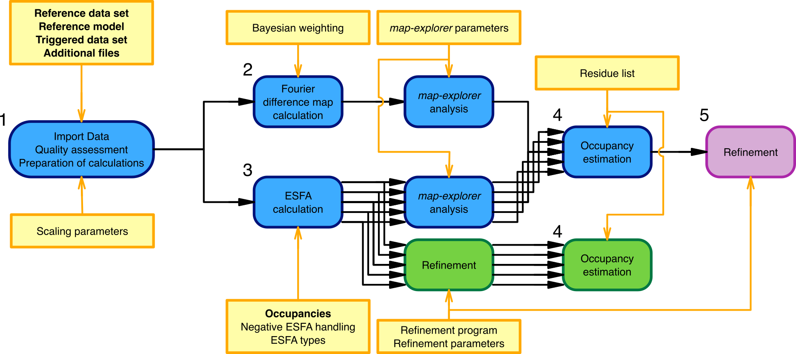
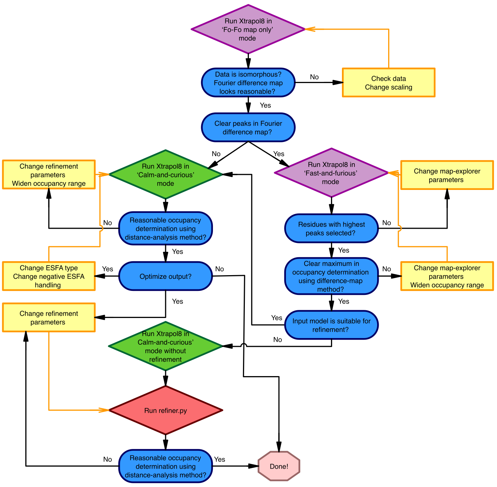
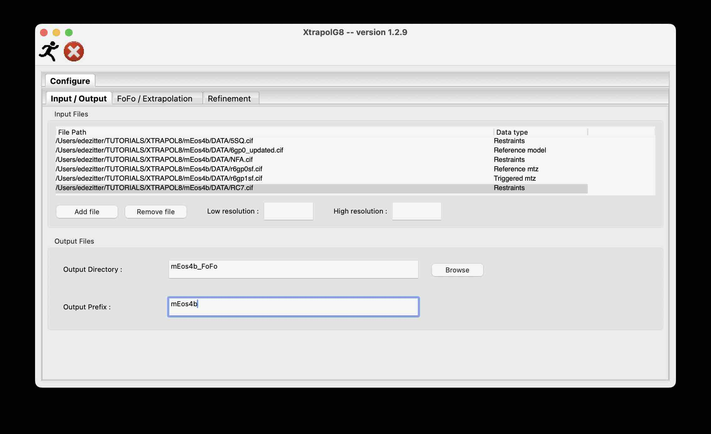
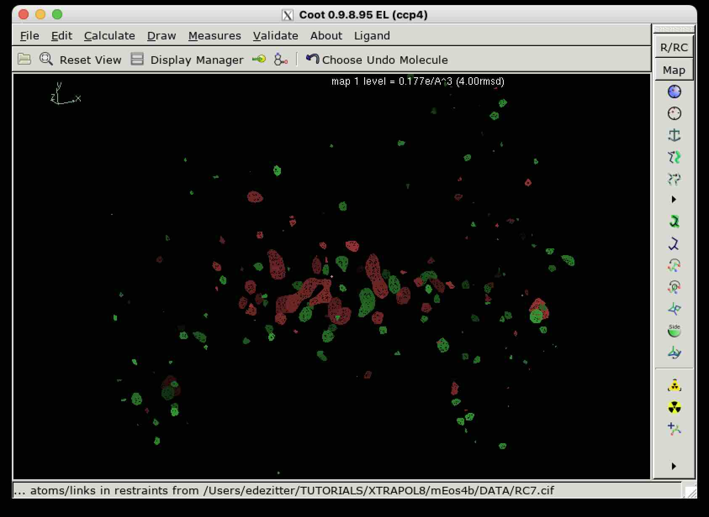
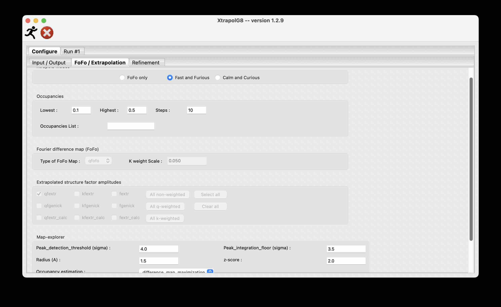
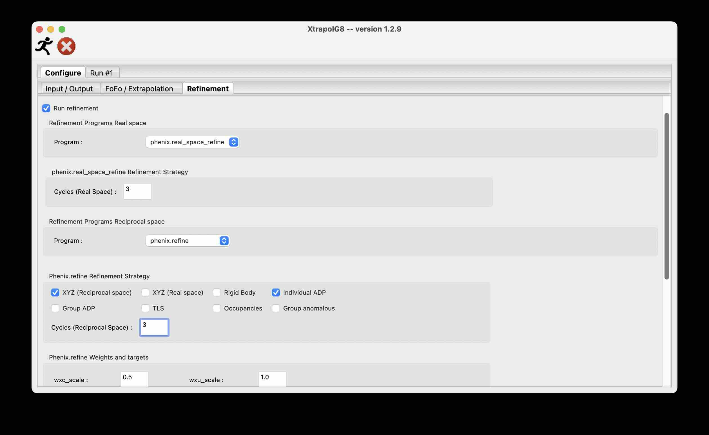
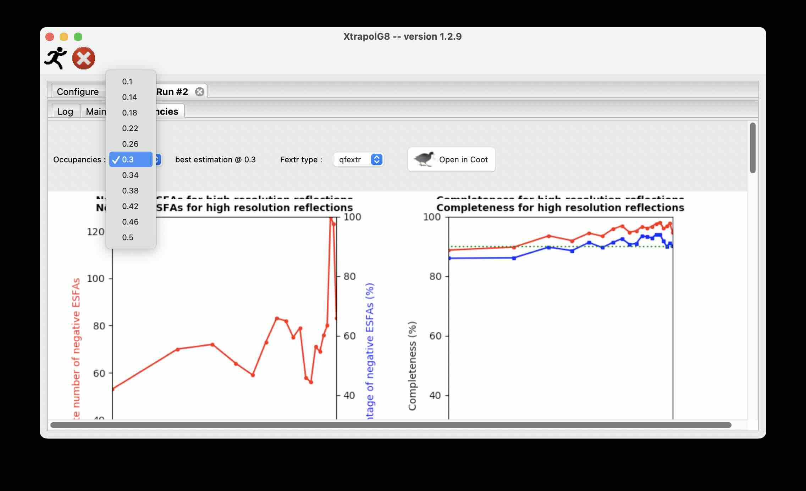
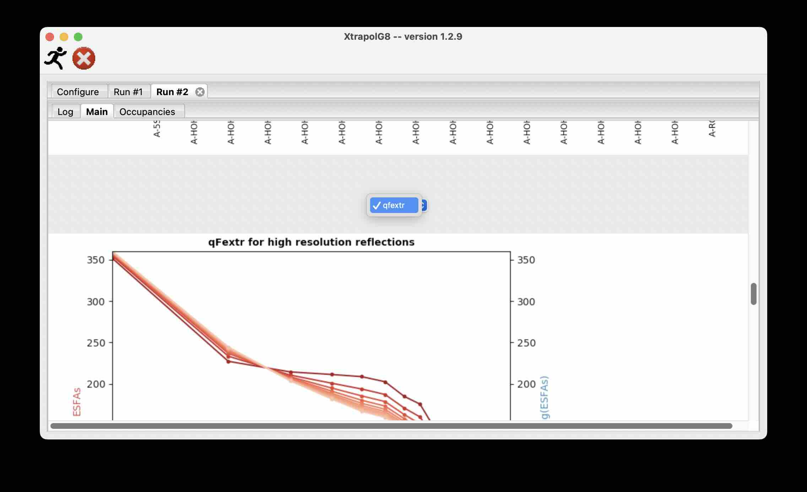
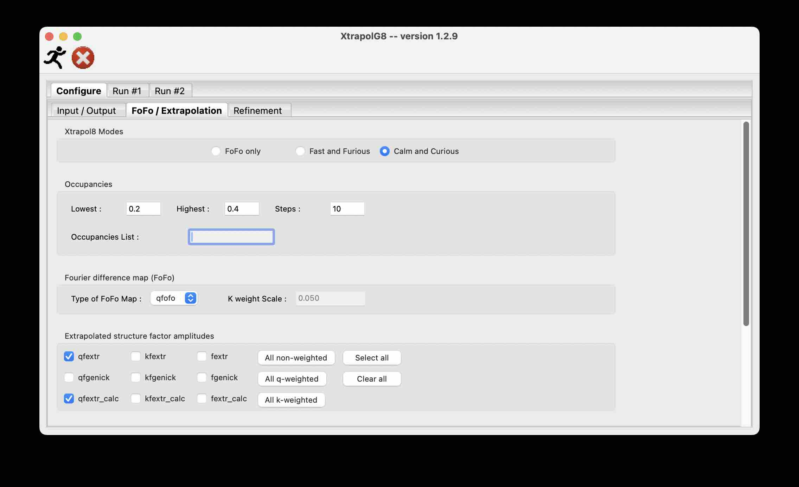
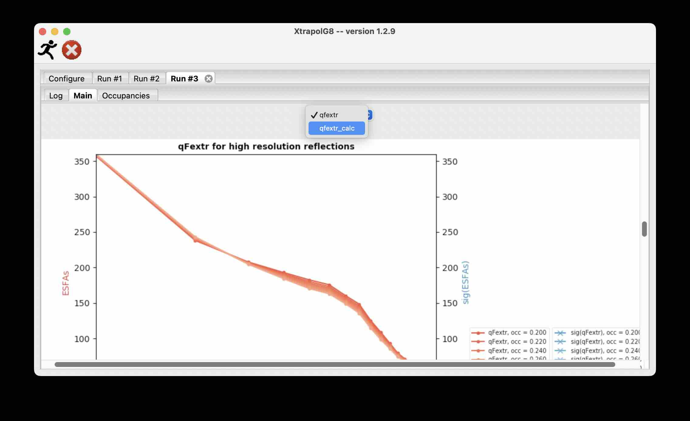

The aim of this tutorial is to reproduce one of the examples from the publication:<br />
De Zitter, E., Coquelle, N., Oeser, P., Barends, T. R. M., Colletier, J.-P., [Xtrapol8 enables automatic elucidation of low-occupancy intermediate-states in crystallographic studies](https://doi.org/10.1038/s42003-022-03575-7), Communications Biology, 5(1), 640 (2022).

# Introduction
Xtrapol8 is software that aims at calculating Bayesian-statistics-weighted Fourier difference (FoFo) maps and extrapolated structure factor amplitudes (ESFAs), and at estimating the occupancy of a low-occupancy state. Xtrapol8 can be downloaded from the [Xtrapol8 GitHub repository](https://github.com/ElkeDeZitter/Xtrapol8).

The code is based on the cctbx toolbox and uses several CCP4 programs. To run Xtrapol8, you need CCP4 (including Coot-1) installed with a valid license. Phenix is optional but recommended (version 1.18 or higher), so that refinement can be done with the Phenix programs.<br />
This tutorial is written for the development version of Xtrapol8 (version 1.2.9-Dev, [develop branch](https://github.com/ElkeDeZitter/Xtrapol8/tree/develop)). This version runs with the Python that comes with CCP4 (`ccp4-python`).<br />

An introduction to Fourier difference maps, structure factor extrapolation and the software itself can be found on the CCP4 YouTube channel: [CCP4 Study Weekend 2022](https://www.youtube.com/watch?v=H21L3-M_ge4) and [CCP4 Study Weekend 2024](https://www.youtube.com/watch?v=t6-7OBwtVts).

If Xtrapol8 was useful in your project, please cite us:<br />
De Zitter, E., Coquelle, N., Oeser, P., Barends, T. R. M., Colletier, J.-P., [Xtrapol8 enables automatic elucidation of low-occupancy intermediate-states in crystallographic studies](https://doi.org/10.1038/s42003-022-03575-7), Communications Biology, 5(1), 640 (2022).<br />

Don't forget to cite the software on which we build:
* Liebschner, D. et al., [Macromolecular structure determination using X-rays, neutrons and electrons: recent developments in Phenix](https://journals.iucr.org/d/issues/2019/10/00/di5033/index.html), Acta Crystallogr. D Struct. Biol. 75, 861–877 (2019).
* Agirre, J. et al., [The CCP4 suite: integrative software for macromolecular crystallography](https://journals.iucr.org/d/issues/2023/06/00/ai5011/index.html), Acta Crystallogr. D Struct. Biol. 79, 449–461 (2023).
* Emsley, P. et al., [Features and development of Coot](https://journals.iucr.org/d/issues/2010/04/00/ba5144/index.html), Acta Crystallogr. D Biol. Crystallogr. 66, 486–501 (2010).
* Grosse-Kunstleve, R. W. et al., [The Computational Crystallography Toolbox: crystallographic algorithms in a reusable software framework](https://journals.iucr.org/paper?ks0118), J. Appl. Crystallogr. 35, 126–136 (2002).

In this tutorial, explanations are mixed with instructions. The latter are preceded by "->" for clarity. Not all available options in Xtrapol8 will be covered. More information about the options and output files can be found in the [Command Line Manual](https://github.com/ElkeDeZitter/Xtrapol8/blob/develop/Xtrapol8_Command_Line_Manual.pdf) and [GUI Manual](https://github.com/ElkeDeZitter/Xtrapol8/blob/develop/XtrapolG8_Manual.pdf).

# Xtrapol8 organization
Processing consists of the following steps:



1. Reading and checking input files, and assessing data quality.
2. Calculating a (weighted) Fourier difference map, integrating the peaks in the map and attributing them to the closest amino acid residues.
3. For each occupancy to test[^1]:<br />
   * Calculating the requested ESFAs and map coefficients.
   * Integrating peaks in the extrapolated difference map and attributing them to the closest amino acid residues.
   * Refining the structures in real and reciprocal space.
4. Estimating the occupancy of the triggered state using the *difference map* methods or the *distance analysis* method.

[^1]: In Xtrapol8, we use the following relationship between extrapolation factor ⍺ and occupancy: ⍺ = 1/occupancy. The occupancies to test need to be adapted or differently interpreted if you would like to use a different association.

# Before you start

More details can be found in the installation instructions in the [Xtrapol8 GitHub repository](https://github.com/ElkeDeZitter/Xtrapol8/tree/develop).

## Prerequisites
You need the [CCP4](https://www.ccp4.ac.uk) software suite with Coot-1, and optionally the [Phenix](https://www.phenix-online.org) software suite. Both have to be set up for use from the command line. On macOS this is done as follows (on Linux, the steps are the same; only the installation paths differ):

1. Add Phenix to your PATH by sourcing the file `phenix_env.sh`, which is located in the Phenix installation folder. Replace the version number with the one you have installed:
   ```bash
   source /Applications/phenix-2.2.1-6174/phenix_env.sh
   ```
2. Add CCP4 to your PATH by sourcing `ccp4.setup-sh` in the same terminal. Again, replace the version with the one you have installed:
   ```bash
   source /Applications/ccp4-9/bin/ccp4.setup-sh
   ```
3. Check that the Phenix, CCP4 and Coot-1 programs can be found (each command should return a path):
   ```bash
   which phenix.refine
   which scaleit
   which ccp4-python
   which coot-1
   ```

To avoid repeating steps 1 and 2 each time you open a new terminal, you can add them to your `~/.zprofile` (default shell on macOS), `~/.bash_profile` or `~/.bashrc` file.

Coot-1 is installed together with CCP4, so it is set up once CCP4 is set up. A Coot-1 installed separately also works, as long as `coot-1` can be found from the command line. This version of Xtrapol8 is not compatible with Coot-0.x versions.

If you do not have Phenix, use the CCP4 programs for refinement: in XtrapolG8, select Refmac5 and Coot in the *Refinement* tab; on the command line, set `refinement.reciprocal_space=refmac5` and `refinement.real_space=coot`.

## Installation
Run all commands below in a terminal in which CCP4 has been set up (see [Prerequisites](#prerequisites)).

1. Clone the Xtrapol8 repository, go into the Xtrapol8 directory and switch to the development branch:
   ```bash
   git clone https://github.com/ElkeDeZitter/Xtrapol8.git
   cd Xtrapol8
   git checkout develop
   ```
   Alternatively, download the repository without git: on the GitHub page, select the `develop` branch, click on "Code" -> "Download ZIP", unzip it, and go into the unzipped directory.
2. Install or update the two dependencies (pypubsub and fonttools):
   ```bash
   ccp4-python -m pip install pypubsub
   ccp4-python -m pip install --upgrade fonttools
   ```
3. Install Xtrapol8 (run this from inside the Xtrapol8 directory):
   ```bash
   ccp4-python -m pip install . --no-deps
   ```
4. Check the installation by printing the Xtrapol8 version:
   ```bash
   xtrapol8-version
   ```

To update an existing installation later, run `git pull` in the Xtrapol8 directory and repeat step 3.

# Let's start

During this tutorial, we follow the steps of the recommended pipeline outlined in the following figure.



-> Open a terminal, make a directory in which you want to work, and move into it:
```bash
mkdir <my_folder>
cd <my_folder>
```

# Running Xtrapol8 and XtrapolG8
## Xtrapol8
After installation, Xtrapol8 is run with the `xtrapol8` command (it is no longer launched with `phenix.python <installation-path>/Fextr.py`).

To get information on all options, the easiest way is to run Xtrapol8 without any arguments on the command line:
```bash
xtrapol8
```
Parameters can be given in an input .phil file, as command line arguments, or both:
```bash
xtrapol8 Xtrapol8.phil
xtrapol8 Xtrapol8.phil refinement.phenix_keywords.refine.cycles=3
```
When run from the command line, Xtrapol8 opens Coot-1 automatically at the end of the run (`output.open_coot=True`, the default).

## XtrapolG8
The graphical user interface (GUI), which we call XtrapolG8, is launched with:
```bash
xtrapol8-gui
```

You can choose to supply the various input files and parameters upon launching XtrapolG8 (e.g. `xtrapol8-gui Xtrapol8.phil`), to fill in the fields manually in the GUI, or to load an input file (*File* > *Open Phil*).
In all cases, each of the files and parameters can be altered afterwards. An example input .phil file with [all options](https://github.com/ElkeDeZitter/Xtrapol8/blob/develop/Xtrapol8_example.phil) and an example with [some minimal options](https://github.com/ElkeDeZitter/Xtrapol8/blob/develop/Xtrapol8_minimal.phil) can be found in the Xtrapol8 GitHub repository.

## Other Xtrapol8 commands
The installation also provides the following command line tools. They are not used in this tutorial:

| Command | Purpose |
| --- | --- |
| `xtrapol8-refiner` | Run the automatic refinements and subsequent analyses separately, e.g. after manual intervention on the model (replaces *refiner.py*; might still contain bugs in this version) |
| `xtrapol8-difference-map-analysis` | Redo the *difference map* occupancy estimation |
| `xtrapol8-distance-analysis` | Redo the *distance analysis* occupancy estimation |
| `xtrapol8-ddm` | Calculate a distance difference matrix between two models |
| `xtrapol8-version` | Print the installed Xtrapol8 version |

# Tutorial data
We will use the mEos4b example, which is also used in the original Xtrapol8 publication. The data and models can be found in [examples/mEos4b/DATA](examples/mEos4b/DATA). They were downloaded from the PDB ([6gp0](https://www.ebi.ac.uk/pdbe/entry/pdb/6gp0) and [6gp1](https://www.ebi.ac.uk/pdbe/entry/pdb/6gp1)). The ligand restraints were generated with phenix.elbow.<br />


| File        | Input type                     | Description |
| ---         | ---                            | ---         |
| r6gp0sf.cif | Reference mtz | Structure factor amplitudes collected on a reference crystal (F<sub>obs,ref</sub>) |
| r6gp1sf.cif | Triggered mtz | Structure factor amplitudes collected on a triggered crystal (F<sub>obs,trig</sub>) |
| 6gp0_updated.cif | Reference pdb | Model refined in the reference structure factor amplitudes |
| 5SQ.cif     | Restraints / Additional files | Restraints for ligand (covalently bonded chromophore in this case) |
| RC7.cif     | Restraints / Additional files | Restraints for ligand (covalently bonded chromophore in this case) |
| NFA.cif     | Restraints / Additional files | Restraints for modified amino acid |

# First Fourier difference map in *FoFo only* mode

-> Launch XtrapolG8 without arguments (if not already open):
```bash
xtrapol8-gui
```

## Input / Output
After launching XtrapolG8, you will land on the *Configure* tab, which contains sub-tabs. The first one is *Input / Output*. Here, you upload your data, model and additional files, and you can alter the resolution and define an output name and output folder.

### Input Files
-> Add the input files:
* Press the *Add file* button and select the six files.
* Assign the appropriate data type to each of the files using the right mouse button. The following data types exist:
  - **Reference mtz**<br />
Data for the reference/ground/untriggered/unperturbed state in mtz or mmcif format. For example, in the case of a photo-induced process, these are the data collected when no laser light is applied; in the case of a compound-induced process, these are the data collected before addition or release of the compound.
  - **Triggered mtz** <br />
Data for the low-occupancy/triggered/excited/perturbed state in mtz or mmcif format. For example, these are the data collected after the crystal(s) have been subjected to laser light, a compound, etc. These data contain the triggered state at low occupancy.<br />
Ideally, the unit cell and space group of these data are identical to those of the reference\_mtz. If this is not the case, the space group and unit cell of the *Reference pdb* will be transferred to this dataset. The isomorphism statistics (Riso and CCiso values) will indicate whether this is allowed.
  - **Reference pdb** <br />
Model for the reference/ground/untriggered/unperturbed state in pdb or mmcif format. Preferably, this model is refined with the reference data.
  - **Restraints / Additional files** <br />
Additional library files for non-standard residues, in cif format. Multiple cif files can be added.

### Resolution boundaries
-> For the first run, we won't alter the resolution boundaries.

### Output prefix and directory
- **Output Prefix**<br />
Name to be used as a suffix or prefix in several output files. The basename of the triggered\_mtz will be used if *Output Prefix* is not specified.
- **Output Directory**<br />
Directory in which the output will be stored. If not specified, the output will appear in a new directory called "Xtrapol8". If the directory already exists and is not empty, Xtrapol8 will create a new one using the specified *Output Directory* name followed by a number.  
Note: when launching Xtrapol8 runs rapidly one after the other, the automatic recognition of already existing output directories will fail and multiple Xtrapol8 runs will try to write in the same directory. This might give errors or pass unnoticed, giving ambiguous results. We thus advise users to change the name of the output directory before launching a new run. 

-> Provide a name for the *Output directory*, e.g. *mEos4b\_FoFo*, and the prefix, e.g. *mEos4b*.



## FoFo / Extrapolation
In the second tab, *FoFo / Extrapolation*, the parameters for the Xtrapol8 run can be specified.

### Xtrapol8 modes
Xtrapol8 has different modes of operation:
- **FoFo only**<br />
Xtrapol8 will stop after the calculation and analysis of the Fourier difference map; ESFAs won't be calculated.
- **Fast and Furious**<br />
Full Xtrapol8 run in which default values are used for several parameters, and structure refinement will only be carried out using ESFAs and maps at the estimated occupancy.<br />
As the name implies, this mode is fast, and hence ideal for a first run to optimize a first set of parameters or to get a fast result.
- **Calm and curious**<br />
Full Xtrapol8 run in which the user has control over all parameters; structure refinement will be run using all ESFAs and maps.

-> Select *FoFo only* mode.<br />
Note that the number of options decreases upon selecting this mode.

### Maps and Scaling
Two Bayesian statistics weighting schemes are provided to scale the difference structure factor amplitudes and the ESFAs. In the *FoFo only* mode, they will only be applied to the |F<sub>obs,trig</sub>| - |F<sub>obs,ref</sub>| difference structure factor amplitudes. When running in the two other modes, the weighting schemes can also be applied to the calculation of ESFAs (see below). Both schemes reduce the contribution of uncertain structure factor values. 

- ***q**-weighting*<br />
*q*-weighting was the first weighting scheme, as described in Ursby and Bourgeois, 1997.
- ***k**-weighting*<br />
*k*-weighting is a simplified version of *q*-weighting introduced by Ren et al., 2001. In the *k*-weighting scheme, the user has the option to specify the *K weight Scale* to be more or less stringent about outlier rejection (default = 0.05).

Using *q*-weighting, *k*-weighting or no weighting, three possible Fo-Fo difference structure factor amplitudes can be calculated, which are used to calculate the Fourier difference map. *q*-weighting is the default.

### Map Explorer
The *Map Explorer* module analyzes the difference maps that are generated during the Xtrapol8 runs. In *FoFo only* mode, it will only analyze the FoFo map. In the other modes, the extrapolated difference maps will also be analyzed and the results will be used to estimate ⍺ (occupancy). It is thus important to find proper working parameters for *Map Explorer*:
- **Peak\_detection\_threshold**<br />
Peak detection threshold, expressed in sigmas (r.m.s.d.). Only peaks with a height equal to or above this value will be integrated.
- **Peak\_integration\_floor**<br />
Floor value for blob integration, expressed in sigmas (r.m.s.d.) (blob = peak consisting of at least 2 voxels). Peaks will be integrated from their maximum value towards this lower bound to avoid integration of noise.
- **Radius**<br />
Maximal radius for blob annotation to the closest amino acid residue. If not defined, the high resolution cutoff (defined or implied by the mtz files) will be used.
- **z\_score**<br />
Z-score cutoff to select only the highest integrated peaks.

-> In a first run, it is good to start with all default options (*qFoFo* map type).<br />

-> Press the *Run* button at the top left (the little running man) to start the first Xtrapol8 run in *FoFo only* mode.

## After the *FoFo only* run
Upon running Xtrapol8, a new tab called "Run\#1" will be added, containing the following:
- **Log**<br />
This tab depicts the Xtrapol8 status and shows the Xtrapol8 log file.
- **Main**<br />
This tab shows the main graphs.<br />
One of the figures of the main tab is, however, not shown (sorry for the bug). It can be visualized if the full run output is reloaded in XtrapolG8:
  - File > *Load Results*
  - Select the output directory

### Coot
When Xtrapol8 is run in *FoFo only* mode, a button to load the model and map in Coot is activated in the *Log* tab. Upon pressing this button, the reference model and FoFo map are automatically loaded in Coot.<br />
The Coot scripts written by Xtrapol8 are made for Coot-1. The Coot button might not work on certain systems, e.g. when the `coot` command on your system starts an older Coot version. The Coot script can then be launched from a terminal with Coot-1:
```bash
coot-1 --no-state-script --script mEos4b_FoFo/coot_all_qFo-Fo.py
```

### Figures in *Main* tab

See the [Command Line Manual](https://github.com/ElkeDeZitter/Xtrapol8/blob/develop/Xtrapol8_Command_Line_Manual.pdf) for examples of the images.

- **Riso and CCiso for high resolution reflections**<br />
Plot indicating the isomorphism between F<sub>obs,trig</sub> and F<sub>obs,ref</sub>, shown as Riso and CCiso as a function of resolution. <br />
An overall Riso value below 10\% indicates that the two data sets are strongly isomorphous. However, this is often not the case and can deteriorate the quality of the maps and final results.
An Riso value below 0.25 for the highest resolution shell is highly recommended, but higher values are tolerated (depending on the case). At low resolution, the Riso value should be below 5\% or at least below 10\%.

- **Average q for high resolution reflections** and **Average k for high resolution reflections**<br />
Plot showing the average q or k values and their range versus resolution.<br />
These plots are always shown, regardless of the selected Bayesian weighting strategy.

- **Summed difference peaks**<br />
Plot showing the positive and negative integrated peak area on top of a 1D representation of the amino acid sequence and secondary structure.<br />
⍺-helices are depicted as pink bars whereas β-strands are depicted by blue triangles; summed positive and negative integrated peaks in the FoFo map are depicted as positive green and negative red bars, respectively.
Ligands and water molecules are shown on a separate plot at the bottom, if they have associated difference map peaks as determined by *Map Explorer*.
For ease of comparison, the y-axis has the same range in all subplots.

### Interpret the results
-> Open the results in Coot and look at the plots in the Xtrapol8 output. Try to answer the following questions:
- Are the data isomorphous?
- Should we restrict the resolution?
- Are the shapes of the q- and k-weight (with *K weight scale*=0.05) plots distinct from each other? What would you conclude from their comparison?
- Are there clear peaks in the Fourier difference maps?
- Can the Fourier difference map be easily interpreted?
- Are difference map peaks found on specific amino acid residues? If you disable the model in Coot, do you find peaks everywhere in the asymmetric unit or only at specified locations? Can you find an r.m.s.d. level that gives you difference map peaks that clearly stand out from the noise?


-> Based on the interpretation of the first results, which parameters would you like to alter? Adapt them and run again. Use the questions from above to evaluate the performance of your new run compared with the first run.

# First *Fast and furious* run
Based on the results from the run(s) in *FoFo only* mode, we can now proceed with full structure factor extrapolation.

## Input / Output
-> In the *Input / Output* tab, change the *Output Directory*, e.g. mEos4b\_fast

## FoFo / Extrapolation
-> In the *FoFo / Extrapolation* tab, change to the *Fast and Furious* mode.<br />
Note that several new parameters have become available, but some parameters will be restricted to their default values and cannot be altered.

### Occupancies
You can specify a list of occupancies to test. This can be done in two ways:
- **Lowest**, **Highest** and **Steps**<br />
Define the lowest and highest occupancies to test and the number of steps between them.
- **Occupancy List**<br />
Provide the specific occupancies to test (separated by a space). If a list is provided, it will override the *Lowest*, *Highest* and *Steps* method to define the occupancies.

-> Adapt the field to test 10 occupancies between 0.1 and 0.5.

### Extrapolated structure factor amplitudes and map coefficients
Different methods for the calculation of ESFAs are implemented in Xtrapol8, but only a single one is used in *Fast and furious* mode.
The *qfextr* type of structure factor amplitude extrapolation is the default one, in which *q*-weighting is applied.

More information concerning extrapolation types can be found in the [Command Line Manual](https://github.com/ElkeDeZitter/Xtrapol8/blob/develop/Xtrapol8_Command_Line_Manual.pdf).


| type | Extrapolated structure factors | Map Coefficients <br /> 2F<sub>extrapolated</sub>-F<sub>calc</sub> type | Map Coefficients <br /> F<sub>extrapolated</sub>-F<sub>calc</sub> type |
| --- | --- | --- | --- |
| qfextr | qF<sub>extr</sub> = ⍺ ⨉ q/\<q\> ⨉ (F<sub>obs,trig</sub>-F<sub>obs,ref</sub>) + F<sub>obs,ref</sub> | 2m\|qF<sub>extr</sub>\|-D\|F<sub>calc</sub>\|, φ<sub>ref,calc</sub> | m\|qF<sub>extr</sub>\|-D\|F<sub>calc</sub>\|, φ<sub>ref,calc</sub> |

with ⍺ = 1/occupancy[^1]<br />

### Map Explorer
An additional parameter has appeared under the *Map Explorer* settings: *Occupancy Estimation*.<br />
Here, the methods to estimate the occupancy of the triggered state can be selected. Xtrapol8 currently has three built-in methods to estimate this. All methods that are compatible with the input parameters will be run and their results shown, but only the selected one will be used for further refinement and analysis.<br />
In the *Fast and furious* mode, the following two *Difference map* methods are available:
- **difference map maximization**<br />
The first *difference map* method uses the Fourier difference (m(\|F<sub>obs,trig</sub>\|-\|F<sub>obs,ref</sub>\|)) and extrapolated difference maps (m\|qF<sub>extr</sub>\|-D\|F<sub>calc</sub>\|). The integrated peaks around the selected residues will be used to estimate the occupancy of the triggered state and annotate the most probable extrapolated structure factors. These steps are automatically done by *Map Explorer*:
  1. Using the peak\_detection\_threshold parameter, select the peaks in the m(\|F<sub>obs,trig</sub>\|-\|F<sub>obs,ref</sub>\|) map that are within the specified radius of an atom in the reference model.
  2. Integrate the m(\|F<sub>obs,trig</sub>\|-\|F<sub>obs,ref</sub>\|) peaks from their maximum value down to the peak\_integration\_floor (if we integrate to zero, we'll get one big blob that spreads over the entire asymmetric unit).
  3. Make a histogram of the m(\|F<sub>obs,trig</sub>\|-\|F<sub>obs,ref</sub>\|) peaks and select only the highest using the z\_score parameter. All map voxels outside of these selected peaks are masked in the following step.
  4. Using the mask, integrate the same peaks in the m\|qF<sub>extr</sub>\|-D\|F<sub>calc</sub>\| map, sum the positive peaks, sum the negative peaks and make the sum of the absolute values, divide by the positive/negative/all peaks of the m(\|F<sub>obs,trig</sub>\|-\|F<sub>obs,ref</sub>\|) map and plot their values and search for the maximum of the sum.
- **difference map Pearson CC**<br />
In the second *difference map* submethod, a standard Pearson correlation coefficient between the m(\|F<sub>obs,trig</sub>\|-\|F<sub>obs,ref</sub>\|) map and the m\|qF<sub>extr</sub>\|-D\|F<sub>calc</sub>\| maps is calculated. Here, the map covering the entire asymmetric unit is used. This should generate a very similar result to the first plot unless noise or artifacts appear, e.g. big peaks in the solvent channel.

-> From the previous *FoFo only* run(s), we already know that strong difference map peaks exist. We can thus start with the default method *difference map maximization*, but we should inspect the results from the *Pearson CC* as well after the run.



## Refinement
In the *Refinement* tab, the parameters for the automatic refinements can be specified.

In *Fast and furious* mode, Xtrapol8 will automatically refine the structure at the best estimated ⍺ (occupancy). It will run three subsequent refinements:
1. Reciprocal space refinement using the ESFAs and *Reference pdb*.
2. Real space refinement using the extrapolated map and *Reference pdb*.
3. Real space refinement using the map and model originating from the reciprocal space refinement (refinement 1).

The following parameters have to be set:
- **Perform Refinement with software** <br />
Real space refinement can be carried out with phenix.real\_space\_refine or with Coot. Real space refinement with Coot uses the Coot-1 headless API (CHAPI); if this cannot be found, Xtrapol8 falls back to phenix.real\_space\_refine.<br />
Reciprocal space refinement can be carried out with phenix.refine or Refmac5. If Refmac5 cannot be found, Xtrapol8 falls back to phenix.refine.<br />
Unticking the box avoids running any type of refinement. This is useful for cases in which a manual intervention is needed before refinement. This can be the case for ligand binding studies, as the ligand is not present in the input model; when the conformational changes are too large to be captured by the automatic refinements; or when a bond breaks. The automatic refinements and subsequent analyses can still be executed using the `xtrapol8-refiner` command (outside the scope of this tutorial).
- **Refinement options**<br />
Depending on the chosen programs, different parameters can be selected. Please consult the Phenix and CCP4 documentation for more information.

-> Select the refinement programs with which you have the most experience. If you have no experience or preference, you can select phenix.refine and phenix.real\_space\_refine with the following parameters:
- *Refinement Strategy*: XYZ (Reciprocal space) + Individual ADP
- *Cycles (Reciprocal space)*: 3
- *Cycles (Real space)*: 3
- *Other options*: Ordered solvent



-> Press the *Run* button to start this first *Fast and Furious* Xtrapol8 run.

## After the *Fast and furious* run
In addition to the *Log* and *Main* tabs, another tab appears in the output:

- **Occupancies**<br />
This tab shows the results for ESFAs, each calculated with a distinct ⍺ value (occupancy).



### Coot
In *Fast and furious* and *Calm and curious* modes (see below), the button to open Coot can be found in the *Occupancies* tab. A Coot session is only generated for the best estimated occupancy, which can be selected from the dropdown menu. Upon pressing this button, several models and maps open:
- Models:
  - Reference model
  - Model from reciprocal space refinement (refinement 1)
  - Model from real space refinement (refinement 2)
  - Model from real space refinement after reciprocal space refinement (refinement 3)
- Maps:
  - 2Fo-Fc and Fo-Fc maps from reciprocal space refinement (refinement 1)
  - 2Fextr-Fc and Fextr-Fc maps directly after extrapolation (the raw extrapolated maps)
  - FoFo map


The Coot script can be launched from the command line with Coot-1 in case the button is not responsive:
```bash
coot-1 --no-state-script --script mEos4b_fast/qweight_occupancy_0.300/coot_all_qFextr.py
```

### Selected figures in the *Main tab*
Several graphs are added in the *Main* tab compared with the output of the *FoFo only* run. Here we discuss only a few of them.<br />
See the [Command Line Manual](https://github.com/ElkeDeZitter/Xtrapol8/blob/develop/Xtrapol8_Command_Line_Manual.pdf) for examples of the images.

In the middle of the *Main* tab, a dropdown menu can be found in which the ESFA type can be selected. In *Fast and furious* mode, only the *qfextr* type is available.

-> From the dropdown menu, re-select *qfextr* as ESFA type to refresh the plots. If this is not working, re-load the results as explained above.



- **qFextr for high resolution reflections**<br />
Plot showing the average ESFAs (red to salmon) and their error estimates (blue to light blue) versus resolution. This plot shows how the ESFA signal and errors evolve when calculated with distinct occupancies.

- **Alpha determination / Occupancy determination**<br />
Plots showing the results of the two *Difference map* methods for the estimation of ⍺ (occupancy). If you would like to use a different association between ⍺ and occupancy, only look at the output of the ⍺ estimation and make the conversion to occupancy accordingly. The top row shows the results of the *difference map maximization* method, and the bottom row shows the results of the *difference map Pearson CC*.

### Selected figures in the *Occupancies tab*
The content of this tab will be adapted for each tested occupancy. You can choose the occupancy for which the results should be depicted from the dropdown menu at the top.

- **qFextr\_FsigF: F/sig(F) for high resolution reflections**<br />
Plot showing the average extrapolated structure factors over the estimated error as a function of resolution. This plot is a different representation of one of the main figures, in which the signal and error values were shown, but makes it easier to see if a resolution cutoff should be applied. F/sig(F) above 1.22 is highly recommended (I/sig(I)=1.5). Restricting the resolution can be done within Xtrapol8 or outside of Xtrapol8 before further structure refinement.

- **Distance difference matrix (ddm)**<br />
Plot showing the differences in atomic positions between the *Reference pdb* and the real space refined model. This plot is only generated for the model at the best estimated occupancy. Ligands and water molecules are not included in the ddm.

### Interpret the results
-> Open the results in Coot and look at the plots in the Xtrapol8 output. Try to answer the following questions:
- Can a clear maximum in the occupancy estimation be found with the two methods?
- Do the two methods give a different result? How would you interpret a difference between them?
- Should the resolution be restricted?
- Do the extrapolated maps make sense?
- Is the model suitable for automatic refinement (i.e. can the automatic refinements place the triggered model well in the density?)
- Should the refinement parameters be changed?

-> Based on the interpretation of the first *Fast and furious* run, which parameters would you like to alter? Adapt them and run again. Use the questions from above to evaluate the performance of your new run compared with the first run.

# First *Calm and curious* run

## Input / Output
-> In the *Input / Output* tab, change the *Output Directory*, e.g. mEos4b\_calm

## FoFo / Extrapolation
-> In the *FoFo / Extrapolation* tab, change to the *Calm and Curious* mode.
Note that all parameters are enabled and can now be altered.

### Extrapolated structure factor amplitudes and map coefficients
Three different methods for the calculation of extrapolated structure factors can be used:
- **qfextr, kfextr and fextr**<br />
As described in Coquelle et al., 2018.
- **qfgenick, kfgenick and fgenick**<br />
As described in Genick et al., 2007.
- **qfextr\_calc, kfextr\_calc and fextr\_calc**<br />
As described in Terwilliger and Berendzen, 1995.

The additional possibility to weight the structure factor difference leads to nine possibilities:

| type | Extrapolated structure factors | Map Coefficients <br /> 2F<sub>extrapolated</sub>-F<sub>calc</sub> type | Map Coefficients <br /> F<sub>extrapolated</sub>-F<sub>calc</sub> type |
| --- | --- | --- | --- |
| qfextr | qF<sub>extr</sub> = ⍺ ⨉ q/\<q\> ⨉ (F<sub>obs,trig</sub>-F<sub>obs,ref</sub>) + F<sub>obs,ref</sub> | 2m\|qF<sub>extr</sub>\|-D\|F<sub>calc</sub>\|, φ<sub>ref,calc</sub> | m\|qF<sub>extr</sub>\|-D\|F<sub>calc</sub>\|, φ<sub>ref,calc</sub> |
| kfextr | kF<sub>extr</sub> = ⍺ ⨉ k/\<k\> ⨉ (F<sub>obs,trig</sub>-F<sub>obs,ref</sub>) + F<sub>obs,ref</sub> | 2m\|kF<sub>extr</sub>\|-D\|F<sub>calc</sub>\|, φ<sub>ref,calc</sub> | m\|kF<sub>extr</sub>\|-D\|F<sub>calc</sub>\|, φ<sub>ref,calc</sub> |
| fextr | F<sub>extr</sub> = ⍺ ⨉ (F<sub>obs,trig</sub>-F<sub>obs,ref</sub>) + F<sub>obs,ref</sub> | 2m\|F<sub>extr</sub>\|-D\|F<sub>calc</sub>\|, φ<sub>ref,calc</sub> | m\|F<sub>extr</sub>\|-D\|F<sub>calc</sub>\|, φ<sub>ref,calc</sub> |
| qfgenick | qF<sub>genick</sub> = ⍺ ⨉ q/\<q\> ⨉ (F<sub>obs,trig</sub>-F<sub>obs,ref</sub>) + F<sub>obs,ref</sub> | m<sub>dark</sub>\|qF<sub>genick</sub>\|, φ<sub>ref,calc</sub> | m<sub>dark</sub>\|qF<sub>genick</sub>\|-D\|F<sub>calc</sub>\|, φ<sub>ref,calc</sub> |
| kfgenick | kF<sub>genick</sub> = ⍺ ⨉ k/\<k\> ⨉ (F<sub>obs,trig</sub>-F<sub>obs,ref</sub>) + F<sub>obs,ref</sub> | m<sub>dark</sub>\|kF<sub>genick</sub>\|, φ<sub>ref,calc</sub> | m<sub>dark</sub>\|kF<sub>genick</sub>\|-D\|F<sub>calc</sub>\|, φ<sub>ref,calc</sub> |
| fgenick | F<sub>genick</sub> = ⍺ ⨉ (F<sub>obs,trig</sub>-F<sub>obs,ref</sub>) + F<sub>obs,ref</sub> | m<sub>dark</sub>\|F<sub>genick</sub>\|, φ<sub>ref,calc</sub> | m<sub>dark</sub>\|F<sub>genick</sub>\|-D\|F<sub>calc</sub>\|, φ<sub>ref,calc</sub> |
| qfextr\_calc | qF<sub>extr\_calc</sub> = ⍺ ⨉ q/\<q\> ⨉ (F<sub>obs,trig</sub>-F<sub>obs,ref</sub>) + F<sub>calc,ref</sub> | 2m\|qF<sub>extr\_calc</sub>\|-D\|F<sub>calc</sub>\|, φ<sub>ref,calc</sub> | m\|qF<sub>extr\_calc</sub>\|-D\|F<sub>calc</sub>\|, φ<sub>ref,calc</sub> |
| kfextr\_calc | kF<sub>extr\_calc</sub> = ⍺ ⨉ k/\<k\> ⨉ (F<sub>obs,trig</sub>-F<sub>obs,ref</sub>) + F<sub>calc,ref</sub> | 2m\|kF<sub>extr\_calc</sub>\|-D\|F<sub>calc</sub>\|, φ<sub>ref,calc</sub> | m\|kF<sub>extr\_calc</sub>\|-D\|F<sub>calc</sub>\|, φ<sub>ref,calc</sub> |
| fextr\_calc | F<sub>extr\_calc</sub> = ⍺ ⨉ (F<sub>obs,trig</sub>-F<sub>obs,ref</sub>) + F<sub>calc,ref</sub> | 2m\|F<sub>extr\_calc</sub>\|-D\|F<sub>calc</sub>\|, φ<sub>ref,calc</sub> | m\|F<sub>extr\_calc</sub>\|-D\|F<sub>calc</sub>\|, φ<sub>ref,calc</sub> |

with ⍺ = 1/occupancy[^1]<br />

Multiple maps and types can be selected in one run. The buttons **All non-weighted**, **All q-weighted**, **All k-weighted**, **Select all** and **Clear all** facilitate filtering the desired types.<br />

-> Select at least two types of ESFAs. If the results of the *Fast and furious* run were satisfactory, keep *qfextr* as one of the options.

### Map Explorer
An additional method has appeared in the dropdown menu at *Occupancy Estimation*:  

- **Distance analysis** <br />
This method is based on a structural comparison of the *Reference pdb* with the model that underwent reciprocal and real space refinement. The *distance analysis* method also uses the residue list derived from the largest Fourier difference map peaks (residlist\_Zscore\<z-score\>.txt) as found by *Map Explorer*. Hence, even though the maps are not directly used to estimate the occupancy, the *Map Explorer* parameters should be properly set to select the most useful amino acid residues.<br />
Briefly, all interatomic distances between the atoms of the refined and reference pdb files are calculated for the selected residues and plotted versus ⍺. To each of the distance evolutions, Xtrapol8 will try to fit a sigmoidal curve, and ⍺ will be estimated at the point where 99\% of the plateau level is reached. The overall estimated ⍺ is calculated as the average of individual estimates. Furthermore, the average of all significant distances is also plotted and a sigmoidal curve fitted to it, which is used as an alternative estimate.<br />
The *distance analysis* method can be useful in cases where the FoFo map does not show high and pronounced peaks. However, its results can be very dependent on the refinement parameters.

In *Calm and curious* mode, there are thus three methods to choose from to estimate the occupancy.
All methods that are compatible with the input parameters will be run and their results shown. However, only the one selected at *Occupancy Estimation* will be used for further analyses.<br />

The large conformational changes that take place upon the light trigger in mEos4b cannot be modelled automatically during the refinement steps. Therefore, running the *Distance analysis* at this stage would not be useful (it can be run after an `xtrapol8-refiner` run, but that is outside the scope of this tutorial).

-> Keep the *Occupancy Estimation* method that you preferred from the *Fast and furious* run.

## Refinement
In the *Calm and curious* mode, Xtrapol8 will automatically refine the structure at all tested ⍺ values (occupancies). Therefore, a sensible *Calm and curious* run will take a while. However, it is important to go through these long runs to explore the full potential of your data.

-> You can run Xtrapol8 based on your findings from the *Fast and furious* run(s) or use the following parameters:
- 10 occupancies between 0.1 and 0.5
- 2 types of ESFAs: *qfextr* and *kfextr\_calc*
  
- Refinement parameters:
  - phenix.refine and phenix.real\_space\_refine
  - 3 cycles of reciprocal and real space refinement
  - Strategy: XYZ (Reciprocal space) + Individual ADP
  - Ordered solvent
  - Simulated annealing

## After the *Calm and curious* run
The results from the *Calm and curious* run are organized as for a *Fast and furious* run. However, additional graphs are depicted in the *Main* tab, and all analyses are carried out for all selected ESFA types. Halfway down the *Main* tab and at the top of the *Occupancies* tab, a dropdown menu allows you to select the ESFA type for which you want to depict the results.



### Selected figures in *Main tab*

- **Distance analysis between reference and real space refined models**<br />
Plot showing the distance differences between the *Reference pdb* and the models from reciprocal followed by real space refinement as a function of ⍺. The purple lines show the actual distance measurements between the reference and the refined model; the red lines show the sigmoidal fits; the dashed blue line shows the average of all fits; the green line shows the average measured distance; and the full blue line shows the sigmoidal fit to the average distance. The occupancy histogram shows the occupancy estimates from each individual fit.

### Interpret the results
-> Open the results in Coot and look at the plots in the Xtrapol8 output. Try to answer the following questions:
- How do the three occupancy estimation methods relate to each other? Is there a certain method you would trust or not trust in this case? What is the caveat of each method?
- Are the results from the two ESFA strategies similar?
- How would you explain why distinct extrapolation methods yield different estimated occupancy values?

-> Based on the interpretation of this *Calm and curious* run, which parameters would you like to alter or further explore? Adapt them and run again. Use the questions from above to evaluate the performance of your new run compared with the first run.
